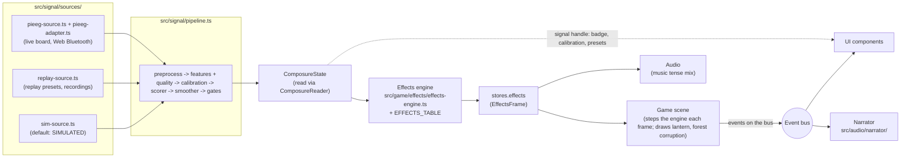

# Architecture (as built)

This describes the code on `main`, not the plan. For the plan, see `docs/PLAN.md`.

## Overview

Lighten Up is a 2D charge-jump climbing game that runs in the browser (Vite, TypeScript, Phaser).
A signal source (a simulator, a replay preset, or a PiEEG Octopus 16 board over Web Bluetooth) feeds
a signal pipeline. The pipeline turns band power into a `ComposureState`: one number for calm versus
tension, plus quality and validity flags. Muscle activity is part of that signal. The game's effects
engine maps the state through a table of capped, smoothed effects (lantern radius, forest corruption,
music mix). The game scene, UI, audio and narrator read the results. The signal never changes
controls or physics. Nothing has been tested on a real Octopus 16 board yet: `recordings/` holds only
a simulated fixture.

## Data flow

## Lanes and the import rule

Each lane is a directory with one owner:

| Lane | Directories |
|---|---|
| Signal | `src/signal/`, `src/config/signal.config.ts`, `src/ui/components/debug-overlay/` |
| Game | `src/game/`, `src/config/game.config.ts`, `src/config/ember.config.ts` |
| UI | `src/ui/`, `src/config/ui.config.ts` |
| Audio and narrator | `src/audio/`, `src/config/audio.config.ts` |
| Content and tuning | `src/content/`, `src/config/effects.config.ts` |

The rule: a lane imports only itself, `src/shared/` and `src/config/`, never another lane.
`src/shared/` imports only `src/shared/`. `src/config/` imports only `src/shared/` and `src/config/`.
`src/main.ts` is the composition root and may import everything.

The test `src/shared/__tests__/lane-boundaries.test.ts` enforces this. It reads every source file's
relative imports and fails if one crosses a lane.

## How src/main.ts wires everything

`src/main.ts` is the only file that knows every lane. In `gameBoot()` it:

1. Creates the event bus with `createEventBus()` (`src/shared/bus.ts`).
2. Creates the stores (`Stores` in `src/shared/contracts/app.ts`): `worldView`, `snapshot`
   (starting from `INITIAL_GAME_SNAPSHOT`), `effects` (starting from `neutralFrame(EFFECTS_TABLE)`)
   and `settings` (`createSettingsStore`, saved to localStorage, with a memory fallback).
3. Creates the signal lane: `createSignal(bus, SIGNAL_CONFIG, { storage })` (`src/signal/index.ts`).
4. Creates the game: `createGame({ ..., composure: signal.reader, effectsTable: EFFECTS_TABLE, ... })`.
   The game gets only the read-only `reader`, never a device or the control surface.
5. Mounts the UI: `mountUi(element, { bus, stores, signal, ... }, UI_CONFIG)` (`src/ui/registry.ts`).
6. Starts audio: `createAudio({ bus, stores, config: AUDIO_CONFIG, narratorLines: NARRATOR_LINES })`.

With `?editor` in the URL, `main.ts` mounts the stage editor instead of the game.
With `?editorTest=<n>` it boots the game at that stage for testing a draft layout.

## Shared contracts, stores and event bus

All shared types live in `src/shared/contracts/`:

| File | What it holds |
|---|---|
| `composure.ts` | `ComposureState` (intensity, resting, restingActive, quality, valid, sampleAgeMs, held, ...), `InputSourceKind`, `SignalMode` |
| `signal-api.ts` | The signal handle the UI uses: `SourceChoice`, `CalibrationResult`, `CalibrationStep`, `SignalDiagnostics` |
| `signal-internal.ts` | Types used only inside the signal lane: `BandFrame`, `Baselines`, `Features`, `Source` |
| `effects.ts` | Effect rows and the `EffectsFrame` |
| `events.ts` | `EventBus`, `GameEvent` and every event type |
| `game-state.ts` | `GameSnapshot`, `INITIAL_GAME_SNAPSHOT` |
| `app.ts` | `Stores` |
| `config.ts`, `content.ts`, `settings.ts`, `world-view.ts` | Config types, section content types, settings, camera view |

Other shared modules:

- `src/shared/store.ts`: `createStore`, a small get/set/subscribe value holder.
- `src/shared/bus.ts`: `createEventBus`, a typed event bus. A listener that throws is logged and does
  not break the others.
- `src/shared/safe-storage.ts`: `getLocalStorage` and `createMemoryStorage`, so blocked storage never
  crashes the game.

Event types on the bus (from `events.ts`): `start`, `jump`, `land`, `fall`, `finish`, `pause`,
`resume`, `section_reset`, `run_restart`, `stage_completed`, `checkpoint_saved`,
`checkpoint_restart_requested`, `precision_window`, `refuge_enter`, `wax_collected`,
`ember_requested`, `ember_assist_requested`, `ember_cancel_request`, `ember_cancelled`,
`ember_gained`, `ember_returned`, `signal_lost`, `signal_restored`, `calibration_result`,
`narrator_line`, `narrator_intro_requested`, `main_menu_requested`.

## Signal pipeline, stage by stage

Sources (`src/signal/sources/`):

- `sim-source.ts`: the simulator. It is the default (`defaultSource: 'SIMULATED'` in
  `src/config/signal.config.ts`).
- `replay-source.ts`: plays back frames. Used for `?source=replay`, built-in presets and saved presets.
  `recording-format.ts` parses recording files. Presets live in `src/signal/presets/`.
- `pieeg-source.ts` and `pieeg-adapter.ts`: the live Octopus 16 board over Web Bluetooth. `?source=live`
  waits for the Connect button, because the browser needs a click. Not verified on real hardware.

URL parameters (`?source=`, `?algo=`, `?mode=fixed`, `?replay=`, `?preset=`) are parsed in
`src/signal/url-params.ts`.

Stages (`src/signal/stages/`), wired together in `src/signal/pipeline.ts`:

The pipeline's own header gives the order as
`frame -> preprocess -> features -> (calibration) -> scorer -> smoother -> gates`.
Quality is estimated beside the features. The chosen algorithm calls `features.ts` and `scorer.ts`.

1. `preprocess.ts`: checks each band frame is finite and non-negative, and judges how fresh it is.
2. `quality.ts`: turns contact quality and packet loss into a 0 to 1 quality score.
3. `features.ts`: computes the raw resting and active-play ratios from band power.
4. `calibration.ts`: collects per-player baselines. Each step (active, resting) has a low half and a
   high half. Active: relaxed play, then jaw clench. Resting: eyes open, then eyes closed.
5. `scorer.ts`: places raw features between the player's own baselines, as 0 to 1 scores.
6. `smoother.ts`: time-based exponential smoothing.
7. `gates.ts`: the safety rules. Decides when the signal can be trusted; invalid data eases effects
   back toward neutral.

The pipeline does maths only. `src/signal/index.ts` adds the source, the clock (about 12 Hz) and the
recorder (`src/signal/recorder.ts`, which can export a session as JSONL).

## Effects as data

Every signal-driven effect is one row in `EFFECTS_TABLE` in `src/config/effects.config.ts`. Each row has
an `enabled` flag, a `min` and `max` (the cap), a `neutral` value, a smoothing time `tauMs`, and a
written `never` rule. The effects engine (`src/game/effects/effects-engine.ts`) applies the table. The game scene
(`src/game/scenes/climb-scene.ts`) steps it every frame, using the state from `ComposureReader`, and
writes the `EffectsFrame` to `stores.effects`. Audio and the debug overlay read that store.

| Row | Enabled | Min | Max | Neutral | tauMs | Never rule (short) |
|---|---|---|---|---|---|---|
| `forestCorruption` | yes | 0 | 1 | 0.2 | 900 | Visual only; landing edges stay readable |
| `lanternRadius` | yes | 90 | 280 | 190 | 1200 | The light never goes out, or changes mid-jump |
| `musicTenseMix` | yes | 0 | 0.8 | 0.15 | 4000 | Music never masks jump and landing sounds |
| `fogDensity` | no | 0 | 0.6 | 0.2 | 2500 | Fog never hides your platform or the next edge |
| `shadowDepth` | no | 0 | 0.7 | 0.4 | 2500 | Shadows never cover hazards |
| `backgroundMotion` | no | 0 | 1 | 0.2 | 3000 | Only distant scenery moves |
| `lanternFlicker` | no | 0 | 0.5 | 0.1 | 1500 | Flicker never drops the light below its minimum |

To turn an effect off, set `enabled: false`. Do not hard-code effect numbers elsewhere.

## The signal never touches controls or physics

The EEG never changes gravity, friction, jump strength, speed or steering. The code enforces this in
two ways:

- `src/game/player/` (movement) must not import `contracts/composure`, `contracts/signal-api` or
  `contracts/signal-internal`. The test `src/shared/__tests__/lane-boundaries.test.ts` fails if it does.
- The game receives only `signal.reader` (a read-only `ComposureReader`). The signal only reaches the
  game through the effects table, whose rows are visual or audio presentation.

## How to add things

A new signal algorithm:

1. Write `src/signal/algorithms/<id>.ts`.
2. Add one line to `ALGORITHMS` in `src/signal/algorithms/registry.ts`.
   Current entries: `intensity-v1`, `intensity-v2` (the default, `defaultAlgo` in
   `src/config/signal.config.ts`) and `passthrough-v0`.
3. Select it with `?algo=<id>`.

A new UI component:

1. Create `src/ui/components/<id>/<id>.ts`.
2. Add it to `COMPONENTS` in `src/ui/registry.ts`.
3. Add its id to `UiComponentId` and to `src/config/ui.config.ts` (these two are integrator changes).

Text comes from `src/ui/strings.ts`; colours, fonts and spacing come from `src/ui/theme/tokens.css`.
Removing a component must never break gameplay.

## Testing and the build

npm scripts (from `package.json`):

| Script | What it runs |
|---|---|
| `npm run dev` | Vite dev server |
| `npm run typecheck` | `tsc --noEmit` |
| `npm run test` | `vitest run` |
| `npm run check` | typecheck, then tests (run before every PR) |
| `npm run build` | `vite build` into `dist/` |
| `npm run build:full` | `node tools/pipeline/build.mjs` |
| `npm run check:levels` | `tsx tools/levels/check-levels.ts` |
| `npm run eval` | `tsx tools/eval/run-eval.ts` (runs recordings through algorithms) |
| `npm run presets:build` | `tsx tools/presets/make-presets.ts` |
| `npm start` / `npm run doctor` | `node run.mjs` / `node run.mjs doctor` |

Tests sit in `__tests__/` folders next to the code in each lane.

The full build pipeline, `tools/pipeline/build.mjs`, runs these steps and stops at the first failure:
preflight, typecheck, tests, levels, bundle (Vite), recordings (copies `recordings/*.jsonl` into
`dist/recordings/`), audit (checks the built page loads nothing from the internet) and stamp
(writes `dist/build-info.json`). `--fast` skips the type check, tests and level check.

GitHub workflows (`.github/workflows/`):

- `ci.yml`: on pushes to `main` (and when another workflow calls it), runs `npm ci`, the history-guard hook self-tests,
  `npm run check` and `npm run build`.
- `pages.yml`: on pushes to `main`, runs `npm ci` and `npm run build`, then deploys `dist/` to
  GitHub Pages. `vite.config.ts` uses base `./`, so the sub-path works.
- `history-guard.yml`: fails if a forced push or a branch deletion reaches GitHub.
