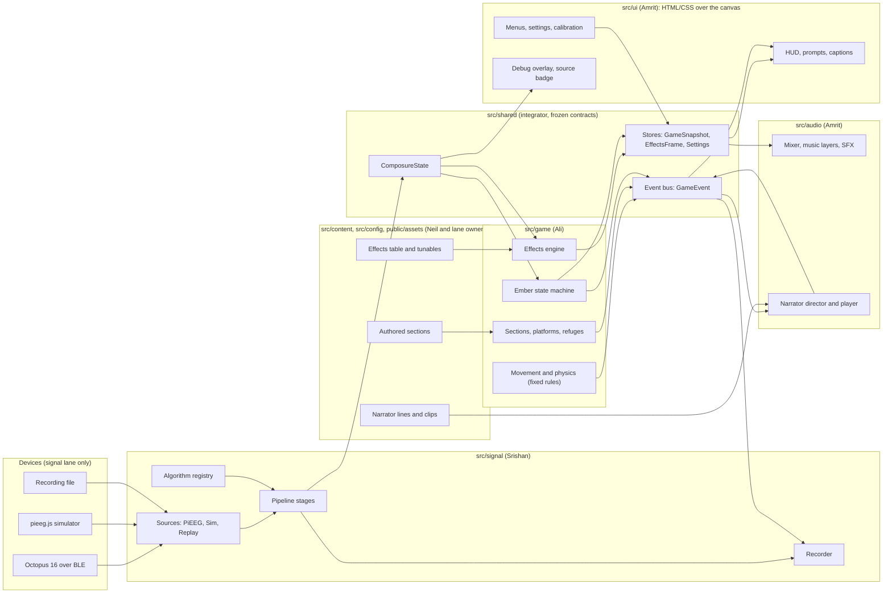
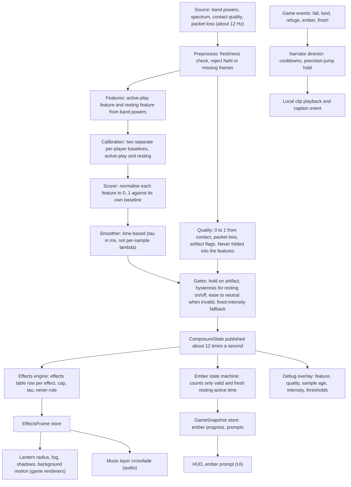

# Master plan: Lighten Up

Written Sat 14 Nov 2026, 7:50 PM Eastern, with 16 h 10 min left before the final Devpost deadline.
Owner: integrator (Srishan). Agents: read [AGENTS.md](../AGENTS.md) first, then the section for your phase.

Every statement is marked **Decision** (a human confirmed it; see [DECISIONS.md](DECISIONS.md)),
**Recommendation** (the architect's, not yet confirmed) or **Unverified** (not checked against a source; see §9).
Versions and API names come from sources opened on 14 Nov 2026 and are linked inline.

---

## 1. Summary and pitch

**Lighten Up** is a 2D charge-jump climbing game played in Chrome or Edge with three keys. You carry a lantern up an
authored tower. You cannot die; a missed jump only costs height. A PiEEG Octopus 16 EEG board on your head feeds a
per-player calibrated signal that changes the world around you, never your controls: when the active-play
*intensity* feature rises, the lantern's reach shrinks, fog thickens and the music tightens; when it eases, they
recover. After a bad fall you can spend your one *recovery ember*: the game freezes, and holding a personalised
resting state for about four valid seconds carries you back to the ledge you fell from. A dry, original narrator
comments on what happens, never on you. It is composure practice and an experimental prototype, not a medical device,
and it does not claim to detect emotion or stress.

**Pitch line:** *A climbing game that never changes your controls, only how far your lantern reaches, and that is
driven live by your own brain signal.*

Credit: the charge-jump climb is in the style of *Jump King*; the narrator's tone is in the spirit of
*Getting Over It*. No voice, line, level or asset from either is reused.

---

## 2. What exists today, and what this plan changes

### What exists (unchanged, keep using it)

| Piece | How to use it |
|---|---|
| Worktrees | `scripts/wt.sh new <agent> <task>` creates `../wt-<agent>-<task>` on branch `<agent>/<task>`. `scripts/wt.sh sync` merges `origin/main` into the branch (never a rebase). `ls` and `rm` list and remove. |
| Per-worktree port | `wt.sh` writes a stable `PORT` (3000 to 3099) into the worktree's `.env.local` and copies untracked `.env*` files in. |
| Agent rules | `AGENTS.md` is the single source of truth. `CLAUDE.md` and `GEMINI.md` import it. |
| AI review | `.github/workflows/ai-review.yml` reviews every non-draft PR. Clean: squash-merged. Problems: `needs-human` label plus a comment. PRs touching shared files or labelled `no-automerge` never auto-merge (a deterministic shell check, not the model, decides this). |
| Subagents | `.claude/agents/feature-builder.md` and `bug-fixer.md`. |
| Hygiene | `.gitattributes` forces LF. `.gitignore` covers `.env*` (except `.env.example`), `node_modules`, build output. |

### What this plan changes

| Change | Where |
|---|---|
| Fills in the project, stack, lanes and folder tree | `AGENTS.md`, `README.md`, this file |
| Adds an approval gate before every phase and subphase | `AGENTS.md` §Approval gate, `docs/plans/` |
| Adds a human-task list with the impact of each task if skipped | `docs/HUMAN_TASKS.md` |
| Adds a universal after-job report, enforced four ways | `docs/agent-reports/TEMPLATE.md`, PR template, `ai-review.yml`, Stop hooks for Claude Code, Codex and Antigravity |
| Adds status, decision and feature registers | `docs/STATUS.md`, `docs/DECISIONS.md`, `docs/FEATURES.md` |
| Widens the no-auto-merge check to the new shared paths | `ai-review.yml` (`src/shared/`, root config, hook configs, `scripts/`, the registers) |
| Names the env variables | `.env.example` |

Nothing in this PR is game code. The scaffold is Phase 0 and waits for approval of [plans/P0.md](plans/P0.md).

---

## 3. Architecture

### 3.1 Fixed foundation versus plug-in features

The feature list is still provisional ([FEATURES.md](FEATURES.md)), so the design separates what never changes from
what can be added, removed or reprioritised cheaply.

| Fixed foundation (built in P0 to P3, needed by every candidate list) | Plug-in (one file or folder plus one line of config or registration) |
|---|---|
| The `ComposureState` contract and `ComposureReader` interface | A signal source (`src/signal/sources/`) |
| The typed event bus and the `GameEvent` list | A composure algorithm (`src/signal/algorithms/` plus a registry line) |
| The stores: `GameSnapshot`, `EffectsFrame`, `Settings` | An effect (one row in `src/config/effects.config.ts` plus one renderer file) |
| The config files, one per concern, all typed | A platform type (`src/game/world/platform-types/` plus a registry line) |
| The UI layer: registry, tokens, strings, settings store | A UI component (`src/ui/components/<name>/` plus a registry line) |
| The composition root `src/main.ts`, the only file that knows every lane | A level section (`src/content/sections/<id>.ts` plus a line in the section list) |
| Lane-boundary test, type check, unit tests, CI | A narrator line or trigger (data in `src/content/narrator/`) |

**How a change to the feature list lands:** removing a feature means deleting its row or registry line; the game
still runs because every consumer treats a missing effect, component or platform type as "off". Adding one means a
new file in one lane. Only a change to a contract in `src/shared/` needs the integrator.

### 3.2 Component diagram



Rules the diagram encodes:

1. **The game never imports a device or the signal lane.** It receives a `ComposureReader` from `src/main.ts`.
2. **Lanes import only `src/shared/` and `src/config/`**, never each other. A unit test enforces this (P0).
3. **Gameplay and signal code never draw UI or hold UI strings.** They publish state and events; the UI subscribes.
4. **EEG never reaches movement.** `src/game/player/` has no access to `ComposureState` at all.

### 3.3 Data flow: device to `ComposureState` to effects and narrator



### 3.4 Contracts (frozen in P0; only the integrator changes them)

These are the starting shapes. P0 turns them into the files named in §3.6 and freezes them.

```ts
// src/shared/contracts/composure.ts
export type InputSourceKind = 'LIVE_EEG' | 'SIMULATED' | 'REPLAY';

export interface ComposureState {
  /** Active-play intensity, 0 (settled) to 1 (most intense). Drives lantern, fog, audio. Already smoothed and capped. */
  intensity: number;
  /** Resting feature normalised against the resting calibration, 0 to 1. For display only. */
  resting: number;
  /** True while the resting target is met, after hysteresis. The ember counts time while this and `valid` are true. */
  restingActive: boolean;
  /** Signal quality, 0 to 1. Separate from the feature values. */
  quality: number;
  /** True only if the latest sample is fresh, quality is above the floor and no artifact gate is holding. */
  valid: boolean;
  /** Age of the newest sample in milliseconds. */
  sampleAgeMs: number;
  /** True while an artifact gate holds the previous values. */
  held: boolean;
  /** 'adaptive' follows the signal. 'fixed' is the active-play fallback: intensity stays at the configured neutral. */
  mode: 'adaptive' | 'fixed';
  calibrated: boolean;
  source: InputSourceKind;
  /** Registry id of the active algorithm, for example 'intensity-v1'. */
  algo: string;
  /** Timestamp in ms on the performance.now() clock. */
  t: number;
}

/** The only signal interface the game may hold. */
export interface ComposureReader {
  getState(): ComposureState;
  subscribe(listener: (state: ComposureState) => void): () => void;
}
```

`intensity` replaces the brief's `C`, `settle` and `tension` because the feature spec asks for two separately
calibrated outputs plus quality. "Composure" stays the player-facing word; in code, composure is `1 - intensity`
and is used only for display. `stress` never appears in UI or Devpost text. **Recommendation.**

```ts
// src/shared/contracts/events.ts — every event also carries `t: number`
export type GameEvent =
  | { type: 'jump'; charge01: number }
  | { type: 'land'; platformId: string; fallHeightPx: number }
  | { type: 'fall'; heightPx: number; big: boolean }
  | { type: 'section_reset'; sectionId: string }           // fell below the section boundary
  | { type: 'refuge_enter'; refugeId: string; firstVisit: boolean }
  | { type: 'checkpoint_saved'; refugeId: string }
  | { type: 'ember_gained' }
  | { type: 'ember_requested' }
  | { type: 'ember_returned'; via: 'eeg' | 'assist' }
  | { type: 'ember_cancelled' }
  | { type: 'precision_window'; active: boolean }           // narrator must stay quiet
  | { type: 'signal_lost' } | { type: 'signal_restored' }
  | { type: 'calibration_result'; ok: boolean; reason?: string }
  | { type: 'pause' } | { type: 'resume' }
  | { type: 'narrator_line'; lineId: string; text: string; durationMs: number } // captions subscribe to this
  | { type: 'finish' };

export interface EventBus {
  emit(event: GameEvent): void;
  on<T extends GameEvent['type']>(type: T, fn: (e: Extract<GameEvent, { type: T }>) => void): () => void;
}
```

```ts
// src/shared/contracts/game-state.ts — what the UI and audio read; the game writes it
export interface GameSnapshot {
  phase: 'menu' | 'calibrating' | 'playing' | 'paused' | 'ember' | 'finished';
  sectionId: string | null;
  altitude01: number;
  ember: { available: boolean; active: boolean; progress01: number; canAssist: boolean };
  prompt: string | null;            // a key into src/ui/strings.ts, never display text
}

// src/shared/contracts/effects.ts
export type EffectId = 'lanternRadius' | 'fogDensity' | 'shadowDepth' | 'backgroundMotion' | 'musicTenseMix' | 'lanternFlicker';
export interface EffectRule {
  id: EffectId;
  enabled: boolean;
  atIntensity0: number;             // output when intensity is 0
  atIntensity1: number;             // output when intensity is 1
  min: number; max: number;         // hard caps, applied last
  unit: string;
  tauMs: number;                    // smoothing time constant
  neutral: number;                  // target when the signal is invalid or mode is 'fixed'
  holdWhileAirborne: boolean;       // lantern radius: fixed from takeoff to landing
  reducedMotionScale: number;       // multiplier when the reduced-motion setting is on
  never: string;                    // the documented never-rule, shown on the debug overlay
}
export type EffectsFrame = Record<EffectId, number>;
```

`Settings` (`src/shared/contracts/settings.ts`) is one typed schema with defaults: key bindings, four volumes
(master, music, SFX, narrator), captions on/off and size, reduced motion, effect strength 0 to 1, landing shake,
HUD visibility flags. It is applied live and saved to `localStorage`.

**Types versus values.** Types live in `src/shared/contracts/` (integrator only). Tunable *values* live in
`src/config/<concern>.config.ts`, each owned by a lane, so tuning never waits on the integrator. A value file must
satisfy its type; a type change is a contract change.

### 3.5 How the UI layer is separated and customised

**Decision:** UI is an HTML/CSS layer positioned over the Phaser canvas, written in plain TypeScript with no framework.

| Requirement | How it is met |
|---|---|
| Gameplay never draws UI | `src/game/` and `src/signal/` have no DOM access and no strings; the lane-boundary test fails the build if they import `src/ui/`. |
| Self-contained components | One folder per component: `src/ui/components/<name>/<name>.ts` plus `<name>.css`. Each exports `mount(root, deps): Unmount` with a typed `deps` object. |
| Registered in one place | `src/ui/registry.ts` lists every component with `{ id, mount, slot, visibleIn: GamePhase[] }`. |
| Shown, hidden, moved or swapped by config | `src/config/ui.config.ts` maps component id to `{ enabled, slot }`. Slots are named CSS grid areas (`top-left`, `top-right`, `bottom-center`, `center`, `full`). Swapping a component is one registry line. |
| One theme | `src/ui/theme/tokens.css` holds every colour, font, size, spacing and z-index as CSS custom properties. Component CSS uses only `var(--…)`. |
| One strings file | `src/ui/strings.ts` holds all player-facing text, keyed. Captions resolve narrator `lineId` to text through `src/content/narrator/lines.ts`. |
| Settings | `src/ui/settings-store.ts` loads, validates against the schema, applies live and saves. |
| Removing a component never breaks gameplay | Components only subscribe. P2 acceptance test: disable every component in `ui.config.ts`; the game still plays. |
| Accessibility | Real DOM gives keyboard focus, readable captions and `prefers-reduced-motion` for free. |

The lantern darkness, fog and scenery are **world rendering inside Phaser**, not UI: they must sit under the
"always readable" platform-edge layer, which only Phaser can order.

### 3.6 Folder tree and lane owners

```
index.html, package.json, package-lock.json, tsconfig.json, vite.config.ts   integrator
public/
  vendor/pieeg.js                 integrator   vendored, pinned commit, MIT
  assets/art/ audio/music/ audio/sfx/ audio/narrator/                        Neil
src/
  main.ts                         integrator   composition root: the only file that imports every lane
  shared/                         integrator   FROZEN after P0
    contracts/                    composure.ts signal-api.ts signal-internal.ts events.ts game-state.ts
                                  effects.ts settings.ts config.ts content.ts app.ts
    bus.ts store.ts               tiny typed event bus and observable store
    __tests__/lane-boundaries.test.ts
    INDEX.md
  config/                         one file per concern, each owned by a lane
    signal.config.ts              Srishan
    game.config.ts ember.config.ts                                           Ali
    effects.config.ts             Neil         the effects table: caps, tau, never-rules
    ui.config.ts audio.config.ts  Amrit
  signal/                         Srishan
    sources/                      sim-source.ts pieeg-source.ts replay-source.ts
    stages/                       preprocess.ts features.ts quality.ts calibration.ts scorer.ts smoother.ts gates.ts
    algorithms/                   registry.ts intensity-v1.ts
    pipeline.ts recorder.ts index.ts
    __tests__/ fixtures/
    INDEX.md
  game/                           Ali
    scenes/                       boot-scene.ts climb-scene.ts
    player/                       movement.ts charge-jump.ts            pure functions, no Phaser, unit tested
    world/                        section-loader.ts refuge.ts bounds.ts platform-types/
    ember/                        ember-machine.ts return-anchor.ts     pure state machine
    effects/                      effects-engine.ts darkness.ts (P0) lantern.ts fog.ts background.ts (P5)
    save.ts index.ts
    INDEX.md
  ui/                             Amrit        (components/debug-overlay/ is owned by Srishan)
    registry.ts types.ts strings.ts settings-store.ts
    theme/tokens.css theme/layout.css
    components/                   main-menu/ pause-menu/ settings-panel/ hud/ source-badge/ captions/
                                  calibration/ ember-prompt/ debug-overlay/
    INDEX.md
  audio/                          Amrit
    mixer.ts music-layers.ts sfx.ts
    narrator/                     director.ts player.ts
    INDEX.md
  content/                        Neil
    sections/                     index.ts section-1.ts section-2.ts    typed, authored level data
    narrator/                     lines.ts triggers.ts                  reviewed lines and event-to-line mapping
    INDEX.md
tools/
  eval/run-eval.ts                Srishan      headless: any algorithm over any recording
  levels/check-levels.ts          Ali          every platform reachable with the real jump maths
  narrator/                       Amrit        draft-lines.ts (Gemini), build-clips.ts (ElevenLabs)
recordings/                       Srishan      band-power sessions only, never raw EEG, no names
docs/                             integrator   PLAN STATUS DECISIONS FEATURES HUMAN_TASKS
  plans/<phase-id>.md             the agent doing that phase
  agent-reports/<stamp>-<agent>-<task>.md      the agent that did the task
scripts/ .github/ .claude/ .codex/ .agents/    integrator
CREDITS.md                        Neil
```

Each lane keeps a short `INDEX.md` listing its public exports with one line each. **Before writing a function,
search `rg` and the lane's `INDEX.md` and extend what exists.**

---

## 4. Tech stack (pinned)

Versions were read from the npm registry with `npm view <pkg> version` on 14 Nov 2026 at 7:20 PM. Pin exact
versions (no `^`) in `package.json`; commit `package-lock.json`; install with `npm ci`.

| Piece | Pinned version | Status | Why |
|---|---|---|---|
| Runtime | Node.js 26 LTS "Lithium" (26.13.x) | Recommendation | Current LTS per [nodejs.org/dist/index.json](https://nodejs.org/dist/index.json); satisfies Vite's `^20.19.0 \|\| >=22.12.0` engine range. |
| Package manager | npm 11 (ships with Node) | Recommendation | Nothing extra to install on four laptops; `package-lock.json` is already in the no-auto-merge check. |
| Game engine | [phaser 4.2.1](https://www.npmjs.com/package/phaser) | **Decision** | Current release, as the team asked. Ships its own types (`types/phaser.d.ts`) and an ESM build. Arcade Physics, scenes and keyboard input are not listed as changed in the [v3 to v4 migration guide](https://cdn.jsdelivr.net/npm/phaser@4.2.1/changelog/v4/4.0/MIGRATION-GUIDE.md); lighting, masks and render textures are. P0 runs a spike; fallback is phaser 3.90.0. |
| Build and dev server | [vite 8.3.8](https://www.npmjs.com/package/vite) | **Decision** | Serves on `localhost` (a secure context, which Web Bluetooth needs), bundles everything for offline use, and reads `.env.local`. |
| Language | [typescript 7.0.2](https://www.npmjs.com/package/typescript), `strict: true` | **Decision** | `AGENTS.md` requires strict typing; the frozen contracts are only enforceable with a type checker. Fallback if Phaser's types or Vitest misbehave: the newest 6.x. |
| Tests | [vitest 5.1.0](https://www.npmjs.com/package/vitest) | Recommendation | Same config as Vite; runs the signal fixtures and pure game functions headless. |
| Script runner | [tsx 4.23.15](https://www.npmjs.com/package/tsx) | Recommendation | Runs the TypeScript tools (`tools/eval`, `tools/levels`, `tools/narrator`) without a build step. |
| EEG SDK | `pieeg.js` 1.3.0-octopus, vendored from [hello_world_octopus_16 at commit 7ea7891](https://github.com/pieeg-club/hello_world_octopus_16/blob/7ea78919d72a81193297222caa07b3c83577497c/pieeg.js) (MIT) | Recommendation | It is a single file, not on npm ([SDK docs](https://docs.pieeg.com/software/api/javascript-sdk/)). The starter-repo copy adds `connectSimulator`, `triggerSimEvent`, `getContactQuality` and packet-loss stats that the docs page does not list. Loaded with a `<script>` tag from `public/vendor/`, never a CDN. |
| UI | Plain TypeScript and CSS, no framework | **Decision** | Uses Amrit's web skills; nothing extra to explain to judges. |
| Backend | None. Node scripts in `tools/` only | **Decision** | Live generation is deferred by the feature spec, so nothing needs a server at the demo. Keys stay in `.env.local` and are read only by build-time scripts. |
| Narrator build tools (P7 only) | [@google/genai 3.3.0](https://www.npmjs.com/package/@google/genai), [@elevenlabs/elevenlabs-js 2.78.0](https://www.npmjs.com/package/@elevenlabs/elevenlabs-js) | Unverified | Versions are from npm; their APIs were not opened this session. The P7 plan must verify them in the official docs before use. |
| Data layer | None | **Decision** | No data prize for now. Run recap, if built, stays in `localStorage`. |
| Lint and format | TypeScript strict only; no ESLint | Recommendation | One less toolchain to keep working overnight. Prettier is optional and not required by CI. |

**Vite and secrets:** Vite exposes any variable prefixed `VITE_` to the browser bundle. API keys must **never** use
that prefix. They are read only by `tools/` scripts through `process.env`.

### Facts about `pieeg.js` that shape the signal design (read from the pinned source)

| Fact | Consequence |
|---|---|
| `new PiEEG({ fftSize, updateHz, bufferSeconds, filter })`; `updateHz` defaults to 12 | The 12 Hz contract rate matches the SDK default. |
| Filter defaults: bandpass 1 to 40 Hz, order 5; **notch off**; Hampel on | We must turn the 60 Hz notch on ourselves (`notch: 60`). The filter settings belong in `signal.config.ts`. |
| `FREQUENCY_BANDS`: Delta 0.5–4, Theta 4–8, Alpha 8–13, Beta 13–30, **Gamma 30–100** | With a 40 Hz low-pass, the "Gamma" value is mostly filtered away. v1 must not rely on gamma unless the bandpass is widened; the Features stage computes its own bands from the spectrum so band edges are ours and typed. |
| `onBandPowers((powers, spectrum) => …)`, powers averaged across channels | The source adapter forwards both; nothing else in the app sees the SDK. |
| `connectSimulator({ device: 'octopus-16' })` and `triggerSimEvent('alpha' \| 'blink' \| 'clench' \| 'noisy_pin' \| 'ssvep', value)` | `SimSource` and `PiEEGSource` share one adapter; the simulator exercises the same filters and FFT as the real board. The starter binds Space to a blink, which collides with our jump key, so `SimSource` uses its own keys from config. |
| `getContactQuality()` returns per-channel `{ rms, status: 'good' \| 'railed' \| 'flat' }`; `getStats()` returns `measuredHz`, `packetsLost`, `packetLossRate` | These feed the `quality` value directly. |
| `connectBLE({ device: 'octopus-16' })` must be called from a click handler; Chromium only; secure context | The calibration screen owns the Connect button; the app is served from `localhost`. |
| The board runs at about 244.14 samples per second, not exactly 250 | Use `measuredHz` for any time maths; smoothing is time-based, not per-sample. |

---

## 5. Install list

### Everyone

| Tool | macOS | Windows | Needed? |
|---|---|---|---|
| Git 2.20+ | `xcode-select --install` or Homebrew | [Git for Windows](https://git-scm.com/download/win), which includes Git Bash | Needed |
| GitHub CLI | `brew install gh` | `winget install GitHub.cli` | Needed |
| Node.js 26 LTS (includes npm) | Installer from [nodejs.org](https://nodejs.org) | Installer from [nodejs.org](https://nodejs.org) | Needed |
| Chrome or Edge, current | Already installed | Already installed | Needed (Web Bluetooth is Chromium only) |
| Bash | Built in | **Git Bash or WSL, not PowerShell**, for `scripts/wt.sh` | Needed |
| Bluetooth LE | Built in. Allow Chrome under System Settings → Privacy & Security → Bluetooth | Built in on both Lenovos | Needed for the board |
| A coding agent | Claude Code, Codex or Antigravity | same | Needed |
| Python 3.11+ | — | — | Optional: only for PiEEG's own Python scripts |
| 7-Zip | — | — | Not needed (only for g.tec's dataset archives, which we do not use) |

### Verify your setup (run in the repo; Git Bash on Windows)

```bash
git --version
gh auth status
node --version
npm --version
bash --version
npm ci
npm run check
npm run dev
```

`npm ci` and the `npm run` commands work only after P0 merges. `npm run check` is type check plus unit tests.
`npm run dev` prints a `localhost` URL; open it in Chrome and confirm you see the canvas and a `SIMULATED INPUT` badge.

### What game development needs that we do not have yet

| Need | Choice | Needed? |
|---|---|---|
| Art | [Kenney](https://kenney.nl/assets) packs (CC0). Log each pack in `CREDITS.md`. No AI-generated textures or models. | Needed |
| Music and SFX | Layered loops and effects from CC0 sources; check each item's licence (Freesound and OpenGameArt vary per item). | Needed |
| Level editor | None. Sections are typed data in `src/content/sections/`, checked by `tools/levels/check-levels.ts`. Tiled is optional and not recommended tonight: it adds a file format and a loader. | Not needed |
| Audio editing | [Audacity](https://www.audacityteam.org/) to trim and level clips | Optional |
| Sprite packing | None; load individual PNGs or the sheets Kenney ships | Not needed |
| Narrator voice | An ElevenLabs stock or designed voice; never a clone or imitation of a real person | Needed for P7 |

---

## 6. Phases and subphases

**Rules for every phase:** write `docs/plans/<id>.md`, wait for `Status: APPROVED by <name>`, build, write the
after-job report, open the PR. Work that needs no human goes first and in parallel; work that depends on a human sits
behind a stub or the simulator.

**Feature gate (Decision, from the brief):** until the finalised feature list is recorded in `FEATURES.md`, only P0,
P1, P2 and P3 may be built. They are needed by every candidate list. P4 onward are planned against the provisional
list and will be re-planned when it is final.

Cut priority: 1 = cut first, 5 = never cut.

| ID | Goal | Lane, owner | Depends on | Parallel with | Clock estimate | Cut |
|---|---|---|---|---|---|---|
| **P0** | Foundation: scaffold, contracts, config schemas, stubs for every seam, tests, CI | Integrator, Srishan | P0 plan approved | Human tasks H-02 to H-08 | Sat 8:45 PM – 10:15 PM | 5 |
| **P1** | Signal core on the simulator | Signal, Srishan | P0 | P2, P3, P8.1 | Sat 10:15 PM – Sun 1:00 AM | 5 |
| **P2** | UI shell | UI, Amrit | P0 | P1, P3 | Sat 10:15 PM – Sun 1:30 AM | 5 |
| **P3** | Real hardware bring-up | Signal, Srishan with Neil | P0, P1.1; a board (H-02, H-03) | P1, P2 | Sat 10:15 PM – Sun 12:00 AM | 5 |
| — | **Feature gate: finalised list (H-01)** | | | | by Sat 10:15 PM | |
| **P4** | Game core: movement, sections, falling, refuges, finish | Game, Ali | P0, feature gate | P1, P2, P3 | Sat 10:15 PM – Sun 2:30 AM | 5 |
| **P5** | Lantern and atmosphere | Game, Ali; tuning, Neil; audio, Amrit | P1.4, P4.2 | P6, P7 | Sun 1:00 AM – 4:30 AM | 5 |
| **P6** | Calibration and recovery ember | Signal + Game + UI | P1, P2, P4.3 | P5, P7 | Sun 1:00 AM – 5:00 AM | 5 |
| **P7** | Narrator | Audio, Amrit; content, Neil | P0 (bus), keys (H-09) | P4 to P6 | Sun 12:30 AM – 5:00 AM | 3 |
| **P8** | Content and presentation | Content, Neil | P4.2 for sections | everything | Sat 10:15 PM – Sun 6:00 AM | 4 |
| **P9** | Submission | Everyone; Devpost, Amrit | — | — | draft by Sat 11:30 PM; final Sun 9:00 – 11:30 AM | 5 |
| **P10** | BCI option: eyes-closed ember | Signal + UI | P6 done and tested | — | only if Core is done by Sun 6:00 AM | 2 |
| **P11** | Expansion platforming | Game + Content | P4 done and tested | — | only if Core is done by Sun 6:00 AM | 1 |
| **P12** | Polish: landing shake | Game | P4 | — | only if Core is done | 1 |

### P0 Foundation

Full detail is in [plans/P0.md](plans/P0.md). Acceptance in one line: on all four laptops `npm ci && npm run check`
passes and `npm run dev` shows a canvas with a box landing on a platform, a `SIMULATED INPUT` badge, and a debug
overlay toggled with the backtick key, all fed by stubs through the real contracts.

### P1 Signal core on SIM (Srishan)

| Sub | Tasks | Acceptance tests |
|---|---|---|
| P1.1 Sources | `pieeg-adapter` wraps the vendored SDK behind a typed `.d.ts`; `SimSource` (`connectSimulator`, keys from `signal.config.ts`, not Space); `ReplaySource` (JSONL of band frames, 1× or faster, runs headless) | With `?source=sim`, the overlay shows band powers changing when the alpha key is held. `ReplaySource` unit test replays a 10 s fixture in under 1 s. |
| P1.2 Features, quality, freshness | `features.ts` computes the active-play feature and the resting feature from the spectrum with our own band edges; `quality.ts` maps contact status and packet loss to 0..1; `preprocess.ts` marks a frame stale after `staleAfterMs` | Fixtures: an alpha rise raises the resting feature; a clench raises the active-play feature; a `noisy_pin` lowers `quality` and leaves the features' scale unchanged; a 600 ms gap sets `valid = false`. |
| P1.3 Calibration | Two separate baselines (active-play and resting), each a pure reducer over frames; a repeatability check (two short windows must agree within a tolerance); a bad calibration is detected and reported | Fixture: resting and active windows that do not separate → `calibration_result { ok: false }` with a reason. |
| P1.4 Scorer, smoother, gates, registry | Normalise, time-based smoothing (`tauMs`), hysteresis with separate on and off thresholds for `restingActive`, ease to neutral when invalid, `mode: 'fixed'` fallback switch; `registry.ts` maps id → algorithm; `?algo=` and `?source=` URL parameters | A new algorithm is one new file plus one registry line (demonstrated with a trivial `intensity-v0-passthrough`). Unit tests for each stage. `?algo=x` shows on the overlay. |
| P1.5 Recorder and evaluation | `recorder.ts` saves band frames, quality and events with timestamps to a downloadable JSONL; `tools/eval/run-eval.ts <algo> <recording>` prints metrics (time valid, mean and range of intensity, resting-active seconds, number of on/off flips) | `npm run eval -- intensity-v1 recordings/sim-fixture.jsonl` prints a table and exits 0. |
| P1.6 Diagnostics | Debug overlay (backtick): feature values, quality, sample age, intensity, thresholds, ember progress, active algorithm; source badge always visible: `LIVE EEG`, `SIMULATED INPUT`, `RECORDED REPLAY` | The badge stays visible with the overlay hidden. Disabling both in `ui.config.ts` breaks nothing. |

Human dependencies: none (all on the simulator). Agents in parallel: up to three (P1.1 → then P1.2/P1.3, P1.5, P1.6 in parallel once the stage interfaces from P0 exist).

**Version 1 algorithm (all values are starting guesses, all in `signal.config.ts`):**
active-play feature `m = (β + γ*) / (θ + α + β + γ*)` where `γ*` is 30–45 Hz and only used if the bandpass is widened
to 45 Hz, otherwise `m = β / (θ + α + β)`; resting feature `a = α / (θ + α + β)`. Each is normalised against its own
calibration window and smoothed with its own `tauMs`. Say openly that `m` is partly muscle activity.

### P2 UI shell (Amrit)

| Sub | Tasks | Acceptance tests |
|---|---|---|
| P2.1 Shell | `tokens.css`, `strings.ts`, `registry.ts`, slot layout, `settings-store.ts` (load, validate, apply live, save) | Changing one token recolours every component. Corrupt `localStorage` falls back to defaults without an error. |
| P2.2 Menus | Main menu, pause menu (pauses gameplay and timers through the bus), settings panel: remapping, four volumes, captions, reduced motion, effect strength | Every control works by keyboard alone. A remapped key takes effect without reload. |
| P2.3 HUD | Ember availability, connection and quality status, interaction prompts, optional signal display | With every HUD component disabled in `ui.config.ts`, the game still plays. |
| P2.4 Captions | Subscribes to `narrator_line`; size and on/off from settings | A fake `narrator_line` event shows the right text for its duration. |

Human dependencies: none. Agents in parallel: two to three (one per sub-phase after P2.1).

### P3 Real hardware bring-up (Srishan, Neil)

| Sub | Tasks | Acceptance tests |
|---|---|---|
| P3.1 `PiEEGSource` | `connectBLE({ device: 'octopus-16' })` from a Connect button; notch 60 Hz on; disconnect and error handling → `signal_lost` | On a real board the badge reads `LIVE EEG` and `sampleAgeMs` stays under 200 ms. |
| P3.2 Quality on real data | Tune `quality` thresholds against real contact data; verify the band edges and the gamma question | Lifting the board off the head drops `quality` and sets `valid = false` within 1 s. |
| P3.3 **Midnight checkpoint** | Eyes open 15 s, eyes closed 15 s, twice, on one teammate, board at Pz; record both runs | The resting feature is clearly higher with eyes closed in both runs, visible on the overlay and in `run-eval` output. Recordings saved under `recordings/`. |

Human dependencies: H-02 (borrow a board), H-03 (flash and fit), H-04 (power bank). **If there is no board by
midnight:** P1 and everything downstream continue on SIM and Replay; P3 moves to the first hour a board is free; the
demo fallback is the simulator plus a recorded real-signal clip, which weakens *Does it work*.
**If the checkpoint fails on a real head:** per the team rule, everything else pauses until it works; first tries are
re-seating the pins at Pz, a different head, then the forehead (blink and clench only).

### P4 Game core (Ali) — after the feature gate

| Sub | Tasks | Acceptance tests |
|---|---|---|
| P4.1 Movement | Pure functions in `player/`: walk, charge up to a fixed maximum, launch by held direction, limited air steering that cannot reverse a launch; all numbers in `game.config.ts` | Unit tests: same input always gives the same arc; air steering changes landing x by at most the configured fraction. `src/game/player/` imports nothing from the signal contract. |
| P4.2 Sections and platforms | Typed section format (platforms, refuge, boundary, finish); `section-loader.ts`; stationary platforms; `tools/levels/check-levels.ts` proves every platform is reachable from a lower one using the same `movement.ts` | `npm run check:levels` passes for both sections and fails on a deliberately unreachable test platform. |
| P4.3 Falling | No death, no health, no lives; falling below the active section boundary returns you to that section's checkpoint; `fall`, `land` and `section_reset` events | Play test: jump off the bottom of section 2 → you reappear at its refuge. |
| P4.4 Refuges and saving | Entering a refuge saves at once with no EEG condition; checkpoint and ember ownership persist in `localStorage`; first arrival refills the ember to one, revisits do not | Reload the page mid-run → resume at the last refuge with the same ember count. |
| P4.5 Finish | Reaching the top wins, with no signal condition | `finish` event fires; the finished screen shows. |

### P5 Lantern and atmosphere (Ali renders, Neil tunes, Amrit audio)

| Sub | Tasks | Acceptance tests |
|---|---|---|
| P5.1 Effects engine | Pure `stepEffects(prev, composure, dtMs, table, settings, airborne) → EffectsFrame`: map, smooth by `tauMs`, cap, hold while airborne, ease to `neutral` when `valid` is false or mode is `fixed` | Unit tests for each rule, including: output never leaves `[min, max]`; the lantern value does not change between takeoff and landing; invalid input eases to neutral and never jumps. |
| P5.2 Lantern | Darkness layer with a light radius from the frame; a "protected visibility" layer above it that always shows the current platform, reachable landing edges and nearby hazards | At intensity 1, a play tester can still see the next ledge in both sections. The light never goes out (`min` > 0). |
| P5.3 Fog, shadows, background motion | Reversible, bounded renderers, each reading one `EffectId` | Holding intensity at 1 for 60 s then 0 for 10 s returns every effect to its low value: nothing accumulates. |
| P5.4 Adaptive audio | Crossfade a tense and a quiet music layer from `musicTenseMix`, capped loudness, SFX never masked | Jump and land sounds stay audible at full tense mix. |
| P5.5 Failure handling | Poor signal eases effects to neutral, pauses ember progress, offers reconnect and recalibration; `mode: 'fixed'` switch in settings and by `?mode=fixed` | Pull the board mid-run: effects ease to neutral within 2 s, progress is kept, the HUD offers reconnect. |

### P6 Calibration and recovery ember (Srishan, Ali, Amrit)

| Sub | Tasks | Acceptance tests |
|---|---|---|
| P6.1 Calibration flow | Screens staged as lighting the lantern: active-play baseline and resting baseline, calibrated separately; pass or fail with a plain reason; recalibrate from pause | A stranger completes it unaided in under a minute. A failed calibration offers retry and the fixed-intensity fallback. |
| P6.2 Ember machine | Pure state machine: `idle → eligible → requesting → activating → returned`, plus `cancelled`; return anchor = last eligible stationary ledge before the fall; only offered when an ember and a useful destination exist | Unit tests for every transition. Moving or unsafe platforms are never chosen as anchors. |
| P6.3 EEG-gated activation | While activating: gameplay and hazards frozen, view stable, visibility raised, audio simplified. Progress accumulates only while `restingActive && valid`; a lapse pauses and never resets; stale data never advances. Target `ember.config.ts → targetValidMs` (starts at 4000) | Fixture replay: 2 s on, 1 s off, 2 s on completes in 5 s of wall time. A frozen sample stream never completes. |
| P6.4 Cancel and assistance | Cancel without spending the ember; recalibrate; a clearly labelled ordinary-input rescue that spends the same ember and emits `via: 'assist'` | Each path works from the keyboard. The source badge shows assistance was used. |
| P6.5 Return | Teleport to the anchor, zero velocity, clear held jump input, consume the ember | No launch fires on arrival even if Space was held throughout. |

### P7 Narrator (Amrit code, Neil content)

| Sub | Tasks | Acceptance tests |
|---|---|---|
| P7.1 Lines | `tools/narrator/draft-lines.ts` (as built: `tools/narrator/build.mjs draft`) asks Gemini for candidates per trigger; a human edits and approves them into `src/content/narrator/lines.ts` | Every shipped line was read by a human. No line comments on the player's emotions, worth or health. |
| P7.2 Clip bank | `tools/narrator/build-clips.ts` (as built: `tools/narrator/build.mjs build`) generates one audio file per approved line with ElevenLabs into `public/assets/audio/narrator/` and writes a manifest; keys from `.env.local` | With Wi-Fi off, every line plays. Re-running the script skips existing clips. |
| P7.3 Director | Bus events → line choice; repetition cooldowns; silent during `precision_window`; mute and narrator volume from settings; emits `narrator_line` | Three falls in ten seconds produce at most one line. No line starts while a jump is charging. |

Human dependencies: H-09 (keys), H-10 (voice and personality approved). **If keys are missing:** the director and
captions are built and tested against silent placeholder clips; captions alone still carry the narrator.

### P8 Content and presentation (Neil)

| Sub | Tasks | Acceptance tests |
|---|---|---|
| P8.1 Assets | Pick CC0 art, music layers and SFX; log each in `CREDITS.md` | Every file in `public/assets/` has a `CREDITS.md` entry. |
| P8.2 Sections | Author two sections of rising difficulty with a refuge between them and a finish (**Decision:** two sections, about two minutes for a stranger) | A first-time player finishes in two to four minutes. `check:levels` passes. |
| P8.3 Progression world changes | Scenery grows darker and stranger with altitude, authored, independent of EEG | Visible in a screenshot at the bottom and at the top with the signal fixed. |
| P8.4 Visual instability (Core polish) | Lantern flicker, swaying scenery, restrained distant distortion; the gameplay camera never moves with the signal; off under reduced motion | With reduced motion on, none of these animate. |

### P9 Submission (everyone)

Devpost draft by Sat 11:30 PM (Amrit, with whatever exists). Sunday after the freeze: README with the one line on
what worked and what did not, `CREDITS.md`, Devpost copy with tracks, prizes and AI tools listed, the "why EEG instead
of heart rate" answer, a two-minute demo script, the video (3 minutes or less), all four teammates added.

### P10 to P12 (only after every Core item is done and tested)

| ID | Feature (priority in the spec) | Note |
|---|---|---|
| P10 | Optional eyes-closed ember interaction with audio cues (BCI option) | Never required; the UI says eye closure is not proof of calmness. |
| P11 | Moving platforms, disappearing platforms above catch platforms, a wind section, slippery surfaces (Expansion) | All on fixed, visible cycles independent of EEG. Each is one `platform-types/` file. Moving and disappearing platforms are excluded from ember anchors. |
| P12 | Adjustable landing shake, off under reduced motion (Polish) | |

### Considered, not scheduled

Not planned, scaffolded or built. One may be promoted only if every Core item is done and tested, a human records the
promotion in `DECISIONS.md`, and it goes through the normal plan and approval gate. The three marked **stays off** are
never shipped even if promoted, because they conflict with the binding framing and the no-medical-advice rule.

| Feature | Decision | Reason |
|---|---|---|
| Secret changes to gravity, friction, jump strength or airspeed | Cut | Breaks learnability; sensor errors would affect core control. |
| No airborne steering | Cut | The design includes limited air correction. |
| Movement slowdown or aim tremor from EEG | Cut | Adds control impairment on top of reduced visibility. |
| "Maximum anger" detection | Cut | Not established by the signal or calibration. |
| Continuous camera instability | Cut | Harms precision and comfort with no gameplay function. |
| Wind resistance driven by the signal | Defer | Another force to tune; the fixed wind section in P11 is separate. |
| Disappearing or pulsing platforms in the core climb | Defer | Timing, visibility, fall and return-anchor complications. |
| Procedural platform generation | Defer | Needs reachability validation and heavy testing; authored layouts are easier to balance. |
| Stress-driven geometry changes | Cut | Removes stable routes; can strand players. |
| Permanent grimness from accumulated "stress" | Cut | A lasting punishment for a noisy, unvalidated inference. |
| Excessive visual clutter, flashing or distortion | Cut | Hides actionable information. |
| Jump or speed buffs that follow EEG | Cut | Makes reachable distances unpredictable. |
| Calmness-gated automatic saving | Cut | Withholds progress protection exactly when someone struggles. |
| Player-placed checkpoint after 30 calm seconds | Cut | Long interruption, questionable threshold, overlaps the ember. |
| EEG required both to earn and to activate an ember | Cut | Repeats one interaction without adding a decision. |
| Unlimited ember refills at old checkpoints | Cut | Encourages backtracking; removes stakes. |
| Winning through "sufficient mindfulness" | Cut | Not a defensible measurement or a clear objective. |
| Mandatory eyes-closed interaction | Cut | May be offered, never required. |
| Webcam facial model (artifact gate) | Defer | Supplemental only; permission, performance and integration cost. |
| Live Gemini → ElevenLabs generation during play | Defer | Latency, unreviewed text, network dependency. |
| Data prize (Tiger Data or MongoDB Atlas) and a backend | Defer (**Decision**, 14 Nov) | Needs a server, an account and network; the Core list is already long. |
| g.tec Unicorn bridge | Removed (**Decision** D-14, 14 Nov) | The headset is no longer borrowable. Hardware is the Octopus 16 plus test data. |
| Narrator judging emotions or growing cruel with intensity | Cut, **stays off** | Turns an uncertain inference into personal criticism. |
| Stress percentage, emotional rankings or a calmness leaderboard | Cut, **stays off** | Implies accuracy and comparability the system does not have. |
| Therapeutic or mindfulness-training claims | Cut from product claims, **stays off** | Would need evidence beyond a hackathon demo. |
| Puzzles, sockets, light reservoirs, bridges, combat, enemies | Cut | Outside the plain-platformer scope. |

---

## 7. Timeline and cut order

| When (Eastern) | What | Who |
|---|---|---|
| Sat 7:50 – 8:45 PM | Review this PR; approve `plans/P0.md`; hand over the finalised feature list (H-01) | Srishan, team |
| Sat 7:50 PM onward | Borrow, flash and verify a board on cloud.pieeg.com (H-02 to H-04); choose assets (H-07); narrator personality (H-10) | Neil, Ali |
| Sat 8:45 – 10:15 PM | **P0** scaffold; human merges | Srishan + one agent |
| Sat 9:00 – 9:30 PM | Devpost draft workshop, Student Center 310AB | Amrit |
| Sat 10:15 PM | P0 merged. Everyone runs "verify your setup". P1, P2, P3, P4, P8 start in parallel | all |
| Sat 11:30 PM | Devpost draft submitted (**due 12:00 AM**) | Amrit |
| **Sun 12:00 AM** | **Midnight checkpoint** (P3.3): eyes-closed rise on a real board, or everything else pauses | Srishan, Neil |
| Sun 12:15 – 12:30 AM | **Walkthrough 1**: each owner explains their files; anything nobody can explain is simplified or removed | all |
| Sun 12:30 – 5:00 AM | P4 finishes; P5, P6, P7 build; sections become playable. Sleep in shifts of two | all |
| Sun 5:00 – 6:00 AM | First full run on a real board: calibrate → climb → fall → ember → finish | all |
| Sun 6:00 AM | Decision point: start P10 to P12 only if every Core item passes its tests | Srishan |
| Sun 6:00 – 9:00 AM | Playtest on all four heads and one stranger (H-12); tune `effects.config.ts` and `ember.config.ts`; offline test (H-13) | all |
| **Sun 9:00 AM** | **Feature freeze.** Bug fixes, tuning and docs only | all |
| Sun 9:30 – 9:45 AM | **Walkthrough 2** (moved from 10 AM so it does not collide with the video workshop) | all |
| Sun 10:00 – 10:45 AM | Demo-video workshop, Halle Library (one person); record the video | Amrit + one |
| Sun 11:30 AM | Final Devpost submission (**hard deadline 12:00 PM**) | Amrit, checked by Srishan |
| Sun 12:00 – 1:15 PM | Rehearse the demo twice with Wi-Fi off; charge the power bank | all |
| Sun 1:15 – 2:15 PM | Live demo, Student Center Ballroom | all |
| Sun 2:15 PM | Return the board | Neil |

**Cut order (first to go first).** P12 landing shake → P11 expansion platforming → P10 eyes-closed option →
P8.4 visual instability → P8.3 progression changes beyond a palette shift → P7.1 Gemini drafting (hand-write the
lines) → settings beyond volumes, captions and reduced motion (drop remapping) → section 2 (ship one section) →
continuous active-play EEG (switch to the spec's fixed-intensity fallback and keep the resting interaction).

**Never cut:** a real signal visibly changing the game, calibration, the recovery ember, pre-generated narrator
clips with captions, the debug overlay and source badge, the simulator fallback.

**Honest sizing.** The Core list in the provisional spec is larger than one night comfortably holds for four
beginners. When you finalise the list, consider moving these out of Core: key remapping, separate audio volumes
beyond a master, persistence between sessions, and Gemini-assisted drafting.

---

## 8. Judging-criteria map

| Criterion | Earned by |
|---|---|
| Does it work | P3 (live board), P1 (simulator and replay fallback), P5.5 (failure handling), the offline test in H-13, P9 demo script |
| Technical challenge | P1 (staged, tested pipeline; swappable algorithms; record and replay evaluation), P3.2 (quality separate from feature), P6.3 (valid-time accumulation with hysteresis) |
| Originality and impact | P5 and P6 (the signal changes visibility and recovery, never control), the honest framing in P9 |
| Design and usability | P2 (three keys, settings, captions), P6.1 (calibration as the opening scene), P5.2 (protected visibility), P8 |
| Learning and growth | The two walkthroughs, `INDEX.md` per lane, header comments, after-job reports, this plan |
| Best Beginner (criteria unpublished) | The same walkthroughs and reports show four beginners can each explain their lane |

---

## 9. Risks and unverified items

### Risks

| Risk | Likelihood | Impact | Mitigation |
|---|---|---|---|
| No board, or the board must go back before 2:15 PM | Medium | High | Ask now (H-02). Simulator and replay paths are first-class; record real sessions as soon as a board is in hand. |
| No clear eyes-closed rise on a real head with dry pins | Medium | High | Midnight checkpoint; try Pz with parted hair, another head, then forehead. The ember can fall back to the labelled ordinary-input rescue. |
| Active-play feature is mostly muscle or too noisy to feel fair | High | Medium | The spec's fixed-intensity fallback is a config switch; say openly that muscle is part of the signal. |
| Phaser 4 lighting or mask API surprises | Medium | Medium | P0 spike of the darkness layer; fallback to phaser 3.90.0 decided in P0, before any game code exists. |
| TypeScript 7 incompatibility with Phaser types or Vitest | Low to medium | Low | P0 acceptance test is `npm run check`; fall back to TypeScript 6.x the same hour. |
| Core list too large for the time | High | High | Cut order in §7; decision point at 6:00 AM; trim the list at the feature gate. |
| Four people and several agents collide | Medium | Medium | Lanes are directories; contracts frozen; lane-boundary test; shared files never auto-merge. |
| Agents approve their own plans or skip reports | Medium | Medium | AGENTS.md rule; Stop hooks; PR template; `ai-review` flags a missing report. Agents commit under the human's git identity, so a self-written approval line cannot be detected automatically: humans must read the plan PR. |
| Many BLE boards in one ballroom interfere | Unknown | High | Ask PiEEG (H-06); pair by the board's `Octopus-16-XXXX` name; rehearse in the ballroom if allowed. |
| Ballroom Wi-Fi fails | High | None if planned | Nothing on the demo path uses the network; offline test (H-13). |
| A judge asks any teammate about any file | Certain | Medium | Two walkthroughs; short single-purpose files; header comment on every module. |
| Recordings of teammates in a public repo | Low | Low | Band powers only, never raw EEG, no names in files; each person agrees before a recording is committed. |

### Unverified (do not rely on these until checked)

| Item | How and when it gets checked |
|---|---|
| Phaser 4.2.1 types compile under TypeScript 7.0.2 strict with Vite 8.3.8 | P0: `npm run check` |
| Arcade Physics behaves as in v3 (the migration guide lists no changes; that is absence of evidence) | P0 spike |
| The vendored `pieeg.js` works as a global via a `<script>` tag under Vite, and `connectSimulator` needs no user click | P1.1 |
| Shape of the `spectrum` argument to `onBandPowers` (expected `psd`, `freqs`, `dominantFreq`) and band-power units | P1.1, by reading the pinned source |
| Whether widening the bandpass to 45 Hz gives a usable 30–45 Hz band on dry pins | P3.2 on real data |
| Web Bluetooth pairing on both Lenovo laptops | H-05 |
| The Claude Code Stop hook fires in a worktree session and blocks once | First agent session after merge; the script itself was tested by hand |
| Codex hook on Windows (the command uses `$(git rev-parse …)`), and that each teammate has trusted the repo's hooks with `/hooks` | First Codex session |
| Antigravity `.agents/hooks.json` schema (top-level hook name → event → handlers) and its working directory | First Antigravity session; check Settings → Customizations → Hooks |
| `@google/genai` and `@elevenlabs/elevenlabs-js` API usage | P7 plan, from official docs |
| Node 26 being the LTS line everyone installs (read from nodejs.org's index, not release notes) | H-08 |
| Best Beginner criteria; whether simulated or replayed signal counts if hardware fails; whether device choice matters | H-06 |
| Availability of the name "Lighten Up" as a domain or Devpost title (name decided, D-23) | H-11 |
| `winget install GitHub.cli` package id on the two Windows laptops | H-08 |

### Sources opened for this plan

[PiEEG JavaScript SDK docs](https://docs.pieeg.com/software/api/javascript-sdk/) ·
[Octopus 16 software docs](https://docs.pieeg.com/hardware/devices/Octopus_16/software/) ·
[hello_world_octopus_16 starter](https://github.com/pieeg-club/hello_world_octopus_16) ·
[PiEEG-server repo](https://github.com/pieeg-club/PiEEG-server) ·
[Phaser v3 to v4 migration guide](https://cdn.jsdelivr.net/npm/phaser@4.2.1/changelog/v4/4.0/MIGRATION-GUIDE.md) ·
[Claude Code hooks](https://code.claude.com/docs/en/hooks) ·
[Codex hooks](https://learn.chatgpt.com/docs/hooks) ·
[Antigravity hooks](https://antigravity.google/docs/hooks) ·
[Antigravity rules](https://antigravity.google/docs/rules) ·
npm registry (`npm view`) · [nodejs.org release index](https://nodejs.org/dist/index.json)
